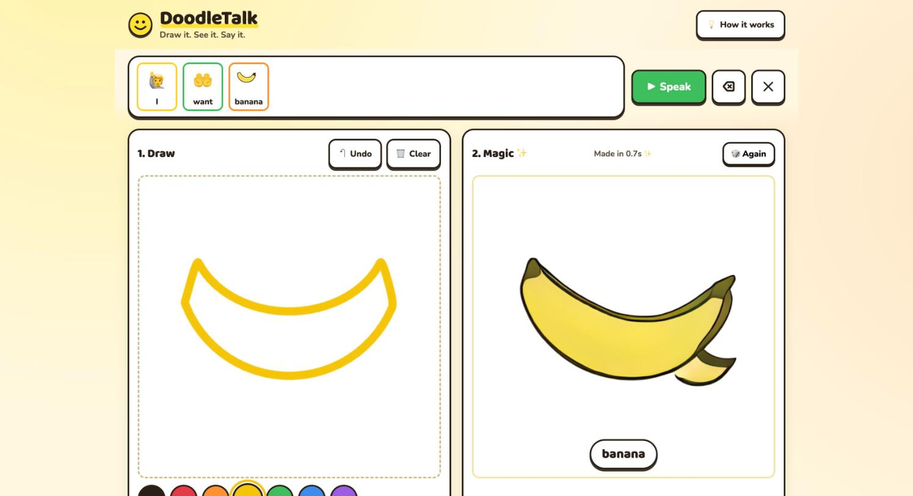
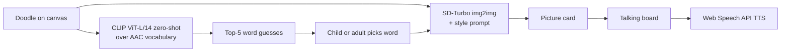

# DoodleTalk

**Draw it. See it. Say it.** Turn a child's scribble into a clean AAC picture card, then tap cards to speak, all running locally on your own machine.

Built for Banana Hacks 2026 (theme: generative AI and image creation).



## The problem

Augmentative and alternative communication (AAC) lets people who cannot rely on speech communicate with pictures, symbols and speech output. ASHA cites estimates that [about 5 million Americans may benefit from AAC](https://www.asha.org/Practice-Portal/Professional-Issues/Augmentative-and-Alternative-Communication/) (Beukelman and Light, 2020, as cited by ASHA).

Picture cards are usually generic, often expensive, and fixed. A child who wants *their* banana, *their* cup, or *their* dog may find no card for it, and cannot make one. The vocabulary on the board is decided for the child, not by the child.

## What it does

1. The child (or a parent or therapist) scribbles on a canvas.
2. CLIP guesses which word the doodle means and offers the top 5 guesses as tappable chips (or type your own word).
3. SD-Turbo redraws the doodle as a clean card in a chosen style (pictogram, storybook, clay, crayon), keeping the child's own composition.
4. One tap adds the card to a talking board, grouped by color category.
5. Tapping cards builds a sentence strip ("I" "want" "banana") and speaks it aloud.

## How it works



- **Recognition:** open_clip `ViT-L-14` (`laion2b_s32b_b82k`), zero-shot against an AAC vocabulary of roughly 150 words using the prompt "a simple child's drawing of {word}". No training needed.
- **Generation:** `stabilityai/sd-turbo` img2img, 512x512, a single denoising step, guidance 0.0, with the TAESD tiny autoencoder (`madebyollin/taesd`) swapped in for the full VAE. On a MacBook (M4) a card takes about 0.6 s, measured with `backend/test_client.py` (the full VAE took about 2.2 s at 512px). Set `TINY_VAE=0` to use the full VAE. The strength setting controls how much of the original doodle survives.
- **Speech:** the browser's built-in `speechSynthesis` (Web Speech API).

## Tech stack

- Python, FastAPI, Uvicorn
- PyTorch, Hugging Face diffusers and transformers, accelerate
- open_clip_torch (CLIP ViT-L/14)
- SD-Turbo (Stability AI)
- Vanilla HTML/CSS/JS frontend, no build step, Pointer Events for touch and mouse
- localStorage for the saved board

## Setup and run

Requires Python 3 and either Apple Silicon (MPS) or an NVIDIA GPU (CUDA).

```bash
python3 -m venv --system-site-packages .venv && .venv/bin/pip install -r requirements.txt && .venv/bin/python backend/server.py
```

Then open http://localhost:8000.

The first run downloads the sd-turbo fp16 weights (about 2.6 GB), TAESD (about 10 MB) and the CLIP weights, so expect a wait. After that everything works offline.

## Judging criteria

- **Technical execution:** two models chained in one low-latency pipeline (CLIP for meaning, SD-Turbo for pixels), a typed JSON API, shared pipeline components, debounced live preview, and graceful handling when the backend is unreachable.
- **Innovation:** the child's own drawing is the input and the composition is preserved, rather than generating a generic stock icon from text. Zero-shot CLIP removes the need for a custom doodle classifier.
- **Image AI theme:** img2img generation is the core of the product, with style control and strength as user-facing knobs.
- **Impact:** personalized, instantly made vocabulary for AAC users, at no per-card cost.
- **Design:** large rounded high-contrast UI, 64px minimum touch targets, Fitzgerald-key-like category colors, iPad-width layout.

## Limitations and ethics

- DoodleTalk is **not a replacement for an SLP-designed AAC system**. Vocabulary selection, motor planning and layout consistency matter clinically; this is a tool to complement that work, ideally used with a speech-language pathologist.
- Generated cards can be wrong or inconsistent between styles. CLIP can mis-guess a doodle, so a human always confirms the word.
- We have not run user studies or tested with AAC users. No effectiveness claims are made.
- Zero-shot recognition is limited to the built-in vocabulary (or typed words).
- **Privacy:** everything runs fully local. Models run on the device, the board is stored in the browser, and a child's drawings never leave the machine. No cloud API, no account, no upload. For a tool involving children and disability, this is a deliberate design choice.

## Future work

- LoRA fine-tune SD-Turbo on a consistent pictogram style, for example ARASAAC symbols (check their license terms before use), for more uniform cards.
- Personalized cards from photos of the child's own items.
- Offline iPad app with on-device models.
- Clinician features: board templates, export/print, and vocabulary suggestions.
